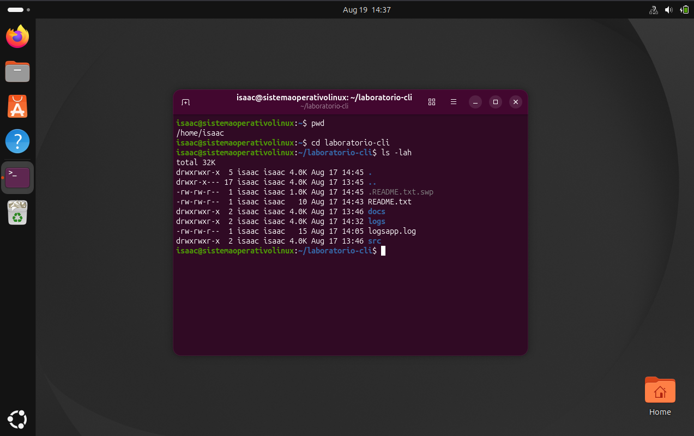

# Permisos de `~/laboratorio-cli`

| Archivo / Directorio | Permisos | Secuencia r-w-x (dueño / grupo / otros) | Octal |
|---|---|---|---|
| `.README.txt.swp` | `-rw-rw-r--` | 420 / 420 / 400 | 664 |
| `README.txt` | `-rw-rw-r--` | 420 / 420 / 400 | 664 |
| `docs` | `drwxrwxr-x` | 421 / 421 / 401 | 775 |
| `logs` | `drwxrwxr-x` | 421 / 421 / 401 | 775 |
| `logsapp.log` | `-rw-rw-r--` | 420 / 420 / 400 | 664 |
| `src` | `drwxrwxr-x` | 421 / 421 / 401 | 775 |

> **Cómo se obtiene el octal:** cada bloque `rwx` vale 4 (lectura) + 2 (escritura) + 1 (ejecución),
> con 0 cuando el permiso no está. `rw-` = 4+2+0 = 6 y `rwx` = 4+2+1 = 7,
> por eso `rw-rw-r--` = 664 y `rwxrwxr-x` = 775.
